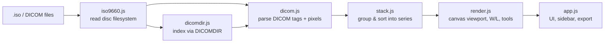

<div align="center">

# DICOM Disc Viewer

**Open the MRI, CT or X-ray disc from your doctor's office right in your browser.**<br />
No install. No upload. Nothing leaves your computer.


<sub>Demo uses a synthetic head phantom generated for this README. No real patient data.</sub>

</div>

> [!WARNING]
> **For personal use only. Not a medical device.**
> This is a hobby project for looking at your own scans out of curiosity. Do **not** use it to diagnose, treat, or make any medical decisions. It is not validated, certified, or approved for clinical use, and images may be displayed incorrectly or incompletely. Always rely on a qualified medical professional and the official radiology report. Provided as-is, with no warranty.

## Why

Imaging centers hand you a CD or an `.iso` with your scans, often bundled with a dated, Windows-only viewer. This project opens that disc image directly in a modern browser, on any OS, without installing anything and without sending private medical images to someone else's server.

## Quick start

1. Download or clone this repo.
2. Open `index.html` in Chrome, Safari, Edge or Firefox.
3. Drag in one or more `.iso` files, or click **Open files…**. Folders of DICOM files and individual DICOM files work too.
4. Pick a series from the sidebar and scroll through the slices.

That's it. There is no build step and no server.

## Features

<table>
<tr>
<td width="50%" valign="top">

**Reads discs directly**
- ISO 9660 disc images, including Joliet names
- Fast indexing via `DICOMDIR`, with a full-scan fallback
- Multiple discs at once, grouped by patient, study and series

</td>
<td width="50%" valign="top">

**Viewing tools**
- Smooth slice scrolling and cine playback (2 to 30 fps)
- Window / level, pan, zoom and fit
- CT window presets (brain, lung, bone and more)
- Length measurements in real units
- Invert, plus a live pixel value probe (HU on CT)

</td>
</tr>
<tr>
<td width="50%" valign="top">

**Export**
- PNG of the current view
- ZIP of a series, a whole scan, or every loaded scan
- ZIP exports leave out patient overlays and measurements

</td>
<td width="50%" valign="top">

**Private by design**
- Files are read straight from disk with browser APIs
- Nothing is uploaded or saved
- Works offline once the page is open

</td>
</tr>
</table>

## Controls

| Input | Action |
|---|---|
| Mouse wheel, <kbd>←</kbd> <kbd>→</kbd> <kbd>↑</kbd> <kbd>↓</kbd> | Previous / next slice |
| <kbd>PgUp</kbd> / <kbd>PgDn</kbd>, <kbd>Home</kbd> / <kbd>End</kbd> | Jump 10 slices, first / last slice |
| Left-drag | Active tool (Window/Level, Pan, Zoom, Measure) |
| Right-drag, pinch | Zoom |
| Middle-drag, <kbd>Space</kbd> + drag | Pan |
| Double-click | Fit to window |
| <kbd>1</kbd> <kbd>2</kbd> <kbd>3</kbd> <kbd>4</kbd> | W/L · Pan · Zoom · Measure tool |
| <kbd>+</kbd> <kbd>−</kbd> <kbd>0</kbd> | Zoom in / out / fit |
| <kbd>i</kbd> <kbd>r</kbd> <kbd>p</kbd> <kbd>c</kbd> | Invert · Reset · Cine · Clear measurements |

Press <kbd>?</kbd> in the app to see these anytime.

## Supported formats

| | |
|---|---|
| ✅ ISO 9660 disc images (incl. Joliet) | ✅ CT, MR, CR / X-ray, secondary captures |
| ✅ Uncompressed DICOM, implicit and explicit VR little-endian | ⚠️ JPEG / JPEG 2000 compressed images are detected but not decoded yet |

## How it works



Everything is plain JavaScript with no dependencies. `iso9660.js`, `dicom.js`, `dicomdir.js` and `stack.js` run in both the browser and Node, which keeps them easy to test.

## Development

```bash
# Unit tests (no data needed)
node test/unit-tests.js

# Tests against real discs (private, gitignored fixtures)
ISO_DIR=/path/to/private/discs node test/run-tests.js
ISO_DIR=/path/to/private/discs node test/e2e-chrome.js
```

Keep private scans out of the repo, or under `data/`, `scans/` or `patient-data/`, which are gitignored.

## Roadmap ideas

- Decode JPEG and JPEG 2000 compressed images
- Side-by-side comparison of two series
- Hosted version on GitHub Pages

---

<div align="center">
<sub>Built by <a href="https://github.com/Gabrielasu">@Gabrielasu</a> · Not a medical device · For personal curiosity only</sub>
</div>
